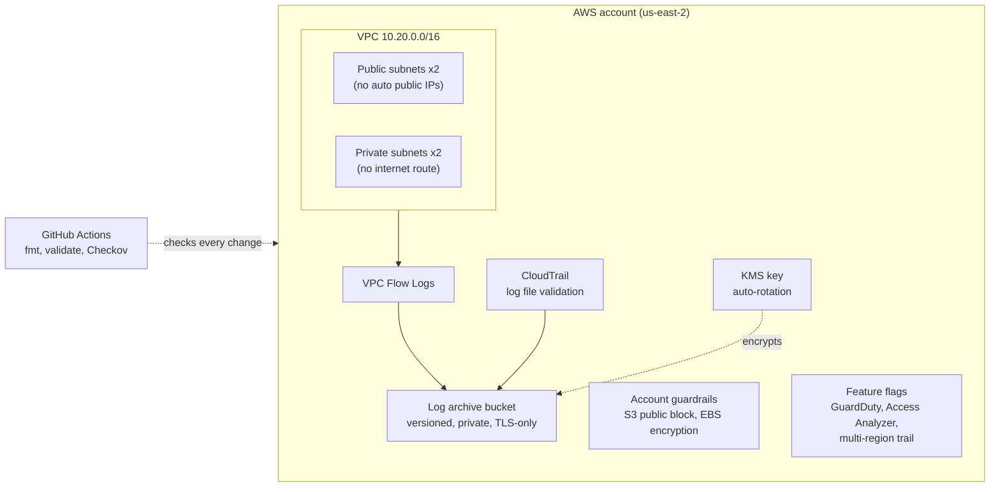

# HIPAA-Ready AWS Landing Zone (Terraform)

[](https://github.com/ShabangTech/aws-hipaa-landing-zone/actions/workflows/terraform-checks.yml)
[](https://github.com/ShabangTech/aws-hipaa-landing-zone/actions/workflows/terraform-deploy.yml)

A security-first AWS foundation built entirely with reusable Terraform modules. It sets up the guardrails a healthcare or other regulated team would expect before any workload goes in: encrypted audit logs, private networking, threat detection, and account-wide security defaults. Every change is format-checked, validated, and security-scanned in CI.

> **Status:** Phases 0 to 3 built. Phase 2 (OIDC deploys) is built and validated in CI; the free "projects" account's service control policy blocks the GitHub OIDC provider, so it is switched off there and runs on a standard account ([CICD.md](docs/CICD.md)). Phases 0 and 1 complete: deployed, verified and torn down in a live AWS account (us-east-2). See the [build log](docs/BUILD_LOG.md) and the [roadmap](docs/ROADMAP.md). Phase 3 (detection and auto-remediation) lives in the companion [aws-cloud-detection-lab](https://github.com/ShabangTech/aws-cloud-detection-lab). New to the acronyms? See the [glossary](docs/GLOSSARY.md).


## Architecture



## What it builds

| Module | What it does |
|---|---|
| [`bootstrap`](bootstrap) | Versioned, encrypted, private S3 bucket for Terraform remote state, with native S3 state locking |
| [`log-archive`](modules/log-archive) | KMS key with rotation plus an S3 bucket that receives CloudTrail and VPC flow logs, locked to the services that write to it |
| [`network`](modules/network) | VPC across two availability zones, public and private subnets, flow logs, and a default security group with every rule removed |
| [`audit-trail`](modules/audit-trail) | CloudTrail with log file integrity validation, encrypted with the log archive key; multi-region behind a flag |
| [`security-baseline`](modules/security-baseline) | Account-wide S3 public access block and default EBS encryption, plus GuardDuty, IAM Access Analyzer and an IAM password policy behind feature flags |

### Works on both kinds of AWS account

New AWS sign-ups (since September 2026) create a free-plan **project** that blocks some services, including GuardDuty, IAM Access Analyzer and multi-region features. Rather than fork the code, those controls are **feature flags** that default to off:

```hcl
# envs/dev/terraform.tfvars, in a standard account or one with advanced features
enable_guardduty       = true
enable_access_analyzer = true
multi_region_trail     = true
```

Same modules, one file of settings per account type.

## How the controls map to HIPAA technical safeguards

This project is a learning lab, not a compliance certification. It shows how common HIPAA Security Rule safeguards translate into cloud controls.

| Safeguard | Control in this repo |
|---|---|
| Audit controls, §164.312(b) | CloudTrail on all regions, VPC flow logs |
| Integrity, §164.312(c)(1) | CloudTrail log file validation, S3 versioning |
| Encryption, §164.312(a)(2)(iv) | KMS-encrypted logs, default EBS encryption |
| Transmission security, §164.312(e)(1) | Bucket policies deny any request not using TLS |
| Access control, §164.312(a)(1) | Least-privilege bucket and key policies, account-wide public access block |
| Activity review, §164.308(a)(1)(ii)(D) | CloudTrail logs; GuardDuty findings and IAM Access Analyzer where the account allows (flags) |
| Password management, §164.308(a)(5)(ii)(D) | IAM password policy (14+ characters, rotation, no reuse), behind a flag |

## Deployed and verified

The [build log](docs/BUILD_LOG.md) walks through the real deployment with screenshots, including two account-guardrail blockers (an SCP that denies regional services in `us-east-1`, and an account type that blocks GuardDuty) and how each was diagnosed and fixed.

| Check | Result |
|---|---|
| `terraform apply` | 26 resources created in us-east-2 |
| CloudTrail `IsLogging` | `true` |
| VPC flow logs | `ACTIVE` |
| Log archive bucket | `cloudtrail/` and `vpc-flow-logs/` arriving, KMS-encrypted |
| `terraform destroy` | 26 resources removed cleanly |
| Rebuild from scratch | 26 created again, then destroyed again |

## Deploys from GitHub with no stored keys

Pull requests get a `terraform plan` comment; merges to `main` apply that exact plan only after a
manual approval. GitHub signs in to AWS with OIDC (short-lived tokens, no access keys), using a
read-only plan role and a least-privilege apply role that only an approved `production` job can
assume. Details and setup: [docs/CICD.md](docs/CICD.md). (Off on AWS "projects" accounts, whose
service control policy denies creating the OIDC provider; see the build log.)

## Cost guardrails

Designed to run at or near $0 on a new account:

- **No NAT gateway**, which would cost about $32 a month. Private subnets have no internet route.
- **GuardDuty** is off by default. Where available it has a 30-day free trial.
- **KMS** costs about $1 a month per key, covered by new-account credits.
- Run `terraform destroy` at the end of each session.

## Quick start

Full step-by-step instructions are in [docs/SETUP.md](docs/SETUP.md).

```bash
# 1. Create the state bucket (once)
cd bootstrap
terraform init && terraform apply

# 2. Deploy the dev environment
cd ../envs/dev
cp backend.hcl.example backend.hcl   # paste in the bucket name from step 1
terraform init "-backend-config=backend.hcl"
terraform plan
terraform apply

# 3. Tear down when finished
terraform destroy
```

## Repository layout

```
bootstrap/                 Remote state bucket (run once)
modules/
  log-archive/             KMS key and encrypted log bucket
  network/                 VPC, subnets, flow logs
  audit-trail/             CloudTrail
  security-baseline/       GuardDuty, Access Analyzer, account guardrails
envs/dev/                  Wires the modules together
cicd/                      GitHub OIDC provider + plan / apply roles (run once)
.github/workflows/         CI: fmt, validate, Checkov; deploy: plan on PRs, approved apply
docs/                      Setup guide, build log, roadmap, glossary of acronyms
```

## Author

**ShabangTech**: CompTIA Security+, U.S. Army veteran, B.S. Information Technology (Security) in progress.
