# Build log: Phases 0 and 1

What it took to stand this landing zone up in a real AWS account, including the two account-policy blockers along the way and how each was diagnosed. Account numbers, usernames and request IDs are blurred.

## 1. Tools

Terraform, AWS CLI v2 and Git installed with `winget` on Windows 11.

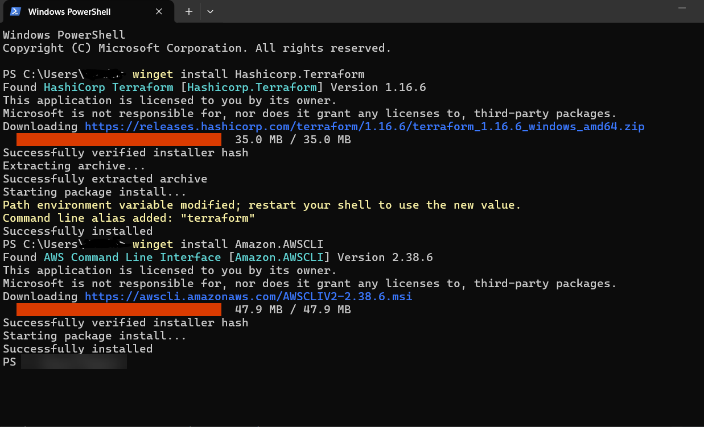

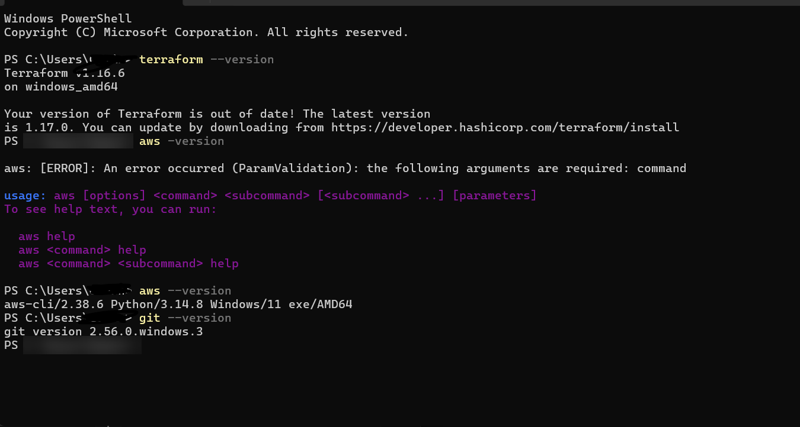

Terraform 1.16.6, AWS CLI 2.38.6 (2.32+ is needed for `aws login`), Git 2.56.

## 2. Blocker 1: the account type

The account was created with AWS's newer sign-up (September 2026), which makes a free-plan **project** owned by an AWS Builder ID. There's no root user and no IAM Identity Center, and GuardDuty, IAM Access Analyzer and multi-region features are blocked.

**Response:**
- Terminal sign-in moved to `aws login`, plus a second CLI profile (`hlz`) that hands Terraform fresh credentials through `credential_process`.
- GuardDuty, Access Analyzer, the IAM password policy and the multi-region trail became **feature flags** that default to off. The same modules still turn them on in a standard account.

## 3. Blocker 2: an explicit deny in a service control policy

The first `terraform apply` of the state bucket failed:

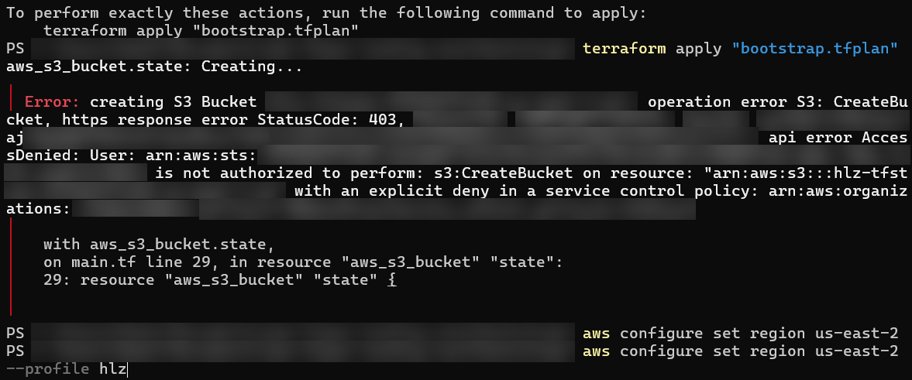

**Diagnosis:**
1. The error names an *explicit deny* in an AWS-managed **service control policy**, so it's an organization guardrail, not missing IAM permissions. No IAM change could fix it.
2. First hypothesis: the SCP requires S3's new account-regional bucket namespace. The bucket was moved to it (`bucket_namespace = "account-regional"`, names ending `-<account>-<region>-an`), which is good practice anyway, but the apply was still denied.
3. Second hypothesis, confirmed: on projects accounts the SCP allows only global services (IAM, Route 53, CloudFront) in `us-east-1`. Regional services must run in the project's **home region**, shown in AWS Settings:

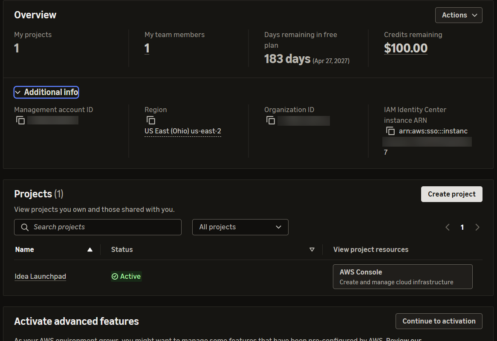

**Fix:** the default region became `us-east-2` in both environments, the backend config and the CLI profiles.

## 4. Remote state (Phase 0)

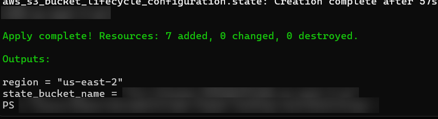

A versioned, encrypted, TLS-only state bucket with public access blocked and native S3 state locking.

## 5. The landing zone (Phase 1)

Every plan was saved with `-out` and reviewed before it was applied.

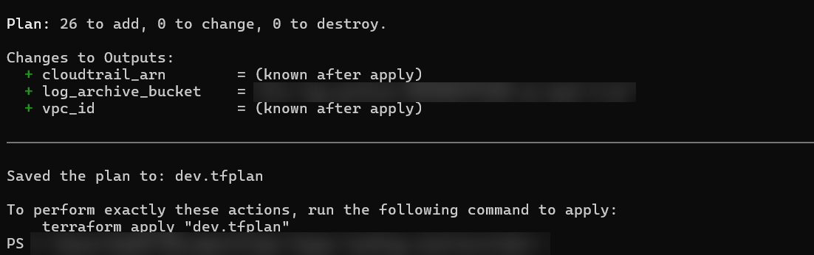

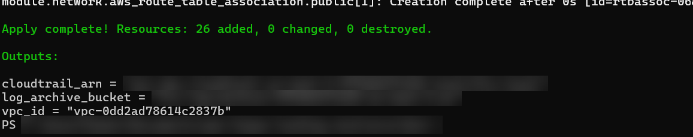

| Module | Resources |
|---|---|
| log-archive | 9 |
| network | 14 |
| audit-trail | 1 |
| security-baseline | 2 |
| **Total** | **26** |

## 6. Verification

CloudTrail is logging, the flow logs are active, and both log streams are landing in the encrypted archive bucket:

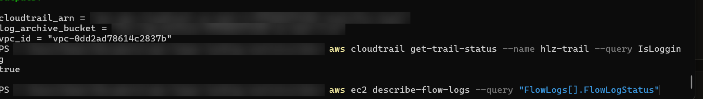

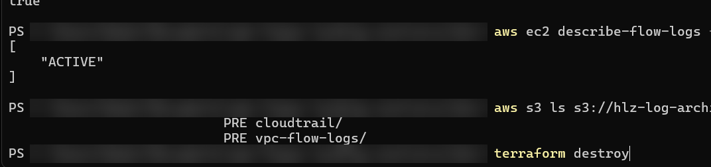

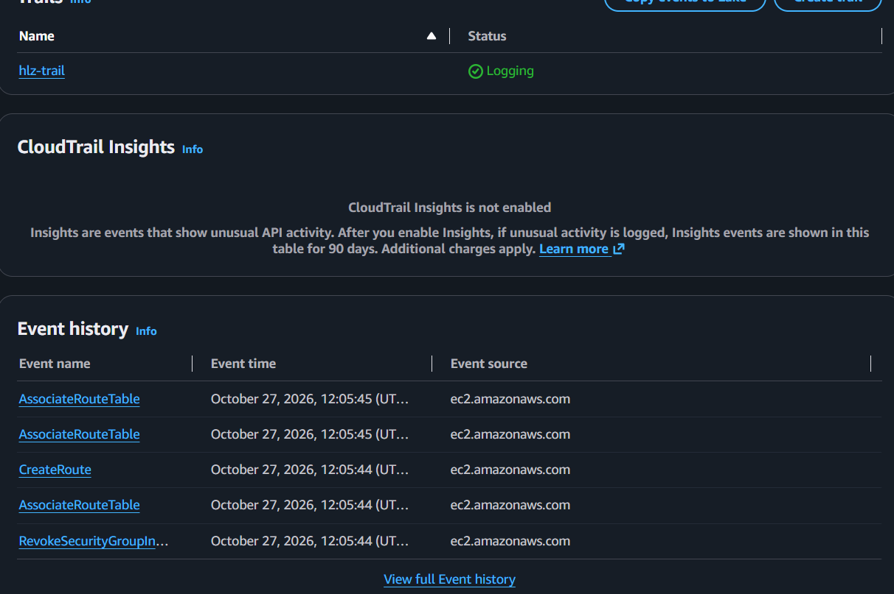

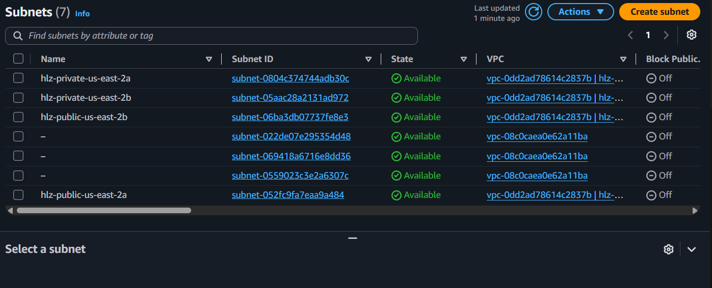

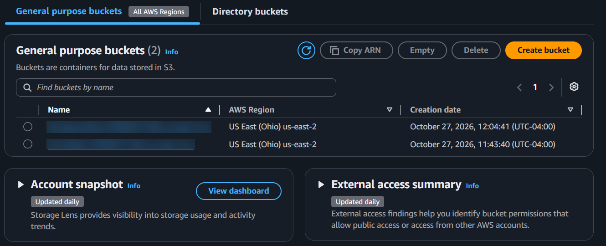

## 7. Tear down

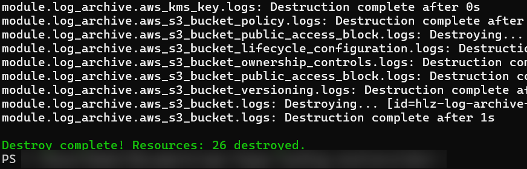

The whole environment is torn down at the end of each session and rebuilt from code in about two minutes. Only the state bucket stays.

**Repeatability check:** after the first teardown, the environment was rebuilt from scratch with a fresh `plan` and `apply` (26 resources), then destroyed again (26 resources). No manual steps, no drift.

## 8. CI/CD with OIDC (Phase 2)

- `cicd/` creates GitHub's OIDC provider and two roles. The trust policies check the token's
  audience (`sts.amazonaws.com`) and subject: the plan role accepts only this repo's pull requests
  and `main`; the apply role accepts only `environment:production`, which GitHub hands out only
  after a reviewer approves.
- The apply role is limited to the landing zone's services; S3 only on `hlz-*` buckets (Checkov
  CKV_AWS_108 caught an earlier `s3:*` on everything); IAM only on `hlz-*` roles; explicit denies
  stop it from touching the OIDC provider, IAM users, access keys or its own roles.
- `apply` runs the saved plan file from the plan job, so what gets deployed is exactly what was
  reviewed. Runs are serialised (`concurrency`) so two can't fight over the state lock.
- Checks: `fmt`, `validate` (bootstrap, cicd, envs/dev), Checkov (152 passed, 0 failed),
  actionlint on both workflows.
- Live test: pending (see [CICD.md](CICD.md#3-test-it)).

## Lessons

- **Read the deny.** "Explicit deny in a service control policy" points at the organization, not IAM, and narrows the search fast.
- **Test one hypothesis at a time.** The namespace change was cheap to try, and ruling it out made the region cause clear.
- **Feature flags beat forks.** One set of modules serves accounts with very different guardrails.
- **PowerShell quirks:** quote `"-out=dev.tfplan"` and `"-backend-config=backend.hcl"`, or PowerShell splits them at the dot.
