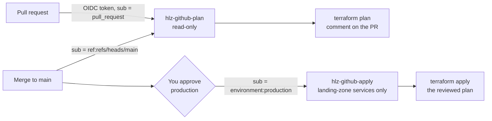

# Phase 2: deploy from GitHub with no stored keys (OIDC)

> **Status (2026-10-30): built and validated, not live on this account.** The pipeline passes
> `fmt`, `validate`, Checkov and actionlint in CI. Deploying `cicd/` to the AWS "projects"
> account failed at the first resource: AWS's own service control policy (SCP) explicitly denies
> `iam:CreateOpenIDConnectProvider`, so GitHub can't be trusted as an identity provider there.
> Nothing was created. The workflow is switched off (`CICD_ENABLED` unset) so it doesn't fail on
> every pull request. On a standard AWS account it runs unchanged: follow the setup below and set
> `CICD_ENABLED = true`. Details: [build log](BUILD_LOG.md#8-cicd-with-oidc-phase-2).

GitHub Actions deploys the landing zone to AWS without any access key saved anywhere.

| When | What runs | AWS role | Gate |
|---|---|---|---|
| Pull request touching `envs/` or `modules/` | `terraform plan`, posted on the PR as a comment | `hlz-github-plan` (read-only) | none |
| Merge to `main` | plan, then `terraform apply` of that exact plan | `hlz-github-apply` | **you approve** the `production` environment |
| Actions > terraform-deploy > Run workflow | `plan`, `apply` or `destroy` | plan / apply | apply and destroy need **your approval** |

## How it works

1. A workflow job asks GitHub for a signed, short-lived identity token (OIDC, OpenID Connect).
2. AWS checks the token against GitHub's identity provider in your account: it must come from
   `ShabangTech/aws-hipaa-landing-zone`, and from a pull request or `main` (plan role), or from
   the approved `production` environment (apply role).
3. AWS STS (Security Token Service) returns temporary credentials for that one role, for one hour
   at most. Nothing is stored in GitHub that could be stolen and reused.



**Least privilege in the apply role** (`cicd/main.tf`):
- S3 only on buckets named `hlz-*`; KMS, CloudTrail, CloudWatch Logs, EC2 (VPC), GuardDuty and
  Access Analyzer for the four modules.
- IAM only on roles named `hlz-*`, `iam:PassRole` only to CloudTrail, and service-linked roles only
  for GuardDuty and Access Analyzer.
- Explicit **deny** on the OIDC provider, on IAM users and access keys, and on the `hlz-github-*`
  roles: the pipeline can never widen its own access.

The plan job blanks your account number out of the PR comment and masks it in every log.

## Set it up (about 30 minutes, Windows PowerShell)

### 1. Create the provider and roles in AWS (once, from your PC)

```powershell
aws login
$env:AWS_PROFILE = "hlz"
cd $HOME\Documents\aws-hipaa-landing-zone     # wherever your clone is
git pull
cd cicd
Copy-Item terraform.tfvars.example terraform.tfvars
notepad terraform.tfvars                      # paste your state bucket name (same as envs\dev\backend.hcl)
terraform init "-backend-config=..\envs\dev\backend.hcl"
terraform plan "-out=cicd.tfplan"             # expect: 8 to add (quote -out: PowerShell splits it at the dot)
terraform apply cicd.tfplan
terraform output
```

Keep the three outputs open for step 2. If `apply` says the OIDC provider already exists, set
`create_oidc_provider = false` in `terraform.tfvars` and apply again.

### 2. Tell GitHub (repo > Settings)

1. **Environments > New environment** named `production`.
   - Tick **Required reviewers** and add **ShabangTech**. Leave "Prevent self-review" unticked
     (you're the only reviewer).
   - **Deployment branches and tags > Selected branches**: add `main`.
2. **Secrets and variables > Actions > Secrets > New repository secret**, three times:
   - `AWS_PLAN_ROLE_ARN` = the `plan_role_arn` output
   - `AWS_APPLY_ROLE_ARN` = the `apply_role_arn` output
   - `TF_STATE_BUCKET` = your state bucket name
3. **Variables tab > New repository variable:**
   - `CICD_ENABLED` = `true` (the on switch; the workflow does nothing without it)
   - `TF_VAR_CLOUDTRAIL_TO_CLOUDWATCH` = `true` (only if the detection lab is deployed)

They're secrets because the role ARNs contain your account number.

### 3. Test it

1. **Plan on a pull request.** Make a branch, change a comment in `envs/dev/main.tf`, push, open a
   pull request. Within ~2 minutes the PR gets a comment: `terraform plan: envs/dev` and
   `No changes` (or the resources to create, if the landing zone is torn down).
2. **The approval gate.** Actions > **terraform-deploy** > **Run workflow** > `apply`. The plan job
   runs; the apply job shows **Waiting** with a **Review deployments** button. Approve it and
   watch it deploy. Screenshot the waiting job and the green run.
3. **Stay at $0.** Run the workflow again with `destroy` and approve it.

Screenshots worth keeping for the build log: the PR comment, the waiting approval, the green
apply, and the role's trust policy in the IAM console (account number blurred).

## Troubleshooting

| Message | Fix |
|---|---|
| `Not authorized to perform sts:AssumeRoleWithWebIdentity` | The job's subject doesn't match the trust policy: plan from a fork, or apply without the `production` environment. Check the repo name in `cicd/variables.tf`. |
| `Could not load credentials` / empty role | A secret is missing or misspelled (step 2). |
| `AccessDenied ... iam:CreateOpenIDConnectProvider ... explicit deny in a service control policy` | The account's organization forbids it (AWS "projects" accounts do). No permission you hold can override an SCP; use a standard account. See the [build log](BUILD_LOG.md#8-cicd-with-oidc-phase-2). |
| `Too many command line arguments` on `terraform plan -out=...` | PowerShell splits the argument at the dot: quote it, `"-out=cicd.tfplan"`. |
| No runs at all | `CICD_ENABLED` isn't set to `true` (step 2). |
| `Error acquiring the state lock` | Another run (or your PC) holds the lock; runs queue one at a time. Wait, or `terraform force-unlock` from your PC. |
| Apply job skipped | The plan found no changes; nothing to apply. |
